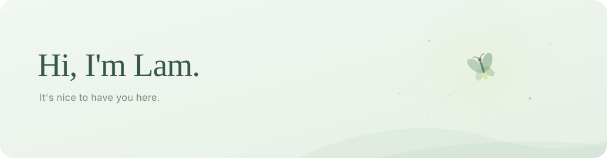

<picture>
  <source media="(prefers-color-scheme: dark)" srcset="./assets/lam-dark.svg">
  <source media="(prefers-color-scheme: light)" srcset="./assets/lam-light.svg">
  
</picture>

<a href="https://github.com/artnguyen23/SArOS">
<picture>
  <source media="(prefers-color-scheme: dark)" srcset="./assets/repository-dark.svg?v=4899081fd679">
  <source media="(prefers-color-scheme: light)" srcset="./assets/repository-light.svg?v=4899081fd679">
  
</picture>
</a>

<picture>
  <source media="(prefers-color-scheme: dark)" srcset="./assets/contributions-dark.svg?v=4899081fd679">
  <source media="(prefers-color-scheme: light)" srcset="./assets/contributions-light.svg?v=4899081fd679">
  
</picture>
